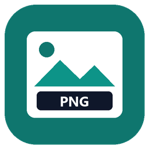
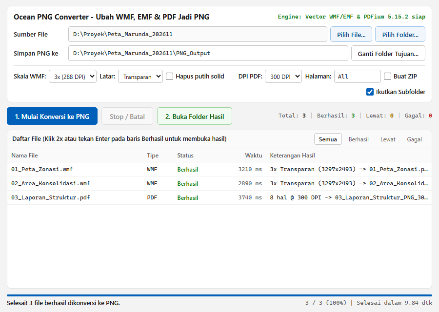
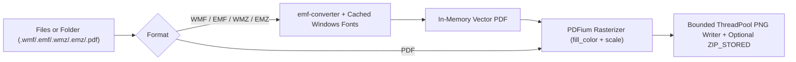

<div align="center">



# Ocean PNG Converter

**Unified WMF / EMF / WMZ / EMZ and PDF to crisp PNG desktop converter for Windows**  
*Drop mixed CAD metafiles, GIS maps, or multi-page PDFs into one queue, keep every hairline vector intact, and export high-DPI PNGs in seconds.*

[](https://github.com/Asikraam/Ocean-PNG-Converter/releases)
[](https://github.com/Asikraam/Ocean-PNG-Converter/releases)
[](https://github.com/Asikraam/Ocean-PNG-Converter/actions)
[](LICENSE)

[Download](#-download--install) · [Recommended Settings](#-recommended-settings) · [How It Works](#%EF%B8%8F-how-it-works) · [Run from Source](#%EF%B8%8F-run-from-source)

<br />



</div>

---

## Key Features

- **One App for Metafiles & PDFs:** Queue `.wmf`, `.emf`, `.wmz`, `.emz`, and `.pdf` files together from file pickers, folder scans (with recursive toggle), or drag-and-drop.
- **No Missing Thin Lines:** Uses `emf-converter` (with on-demand Windows font & CAD `.shx` fallback resolution) followed by Chromium `PDFium` rasterization so thin cosmetic pens, quay hatches, and leader lines render cleanly instead of disappearing under Windows GDI+ `DrawImage`.
- **Parallel PNG Encoding:** Bounded multi-threaded PNG writing (`compress_level=2`), font caching across batches, and `ZIP_STORED` archive packaging cut a 10-page 300 DPI PDF batch from 11.74s to 5.58s (with ZIP enabled).
- **Drafter Workbench Controls:** Live per-file queue table (`Nama File`, `Tipe`, `Status`, `Waktu`, `Keterangan Hasil`), status filter tabs (`Semua`, `Berhasil`, `Lewat`, `Gagal`), `Stop / Batal` (`Esc`), and double-click / `Enter` on finished rows to open the output directly.
- **Independent from `BJ PDF`:** Dedicated app name, teal identity, preferences store, and shortcuts, leaving `BJ PDF` (`BJ-Core`, WMF-to-PDF) completely separate.

---

## 📦 Download & Install

Download **`v1.0.0`** from [**GitHub Releases**](https://github.com/Asikraam/Ocean-PNG-Converter/releases/latest):

| Platform | File | Who It Is For |
| :--- | :--- | :--- |
| **Windows 10 / 11 (x64)** | [`Ocean-PNG-Converter-Setup-v1.0.0-win-x64.exe`](https://github.com/Asikraam/Ocean-PNG-Converter/releases/latest) | **Recommended**: 1-click user installer (Desktop & Start Menu shortcuts) |
| **Windows 10 / 11 (x64)** | [`Ocean-PNG-Converter-v1.0.0-win-x64-Portable.zip`](https://github.com/Asikraam/Ocean-PNG-Converter/releases/latest) | **Portable**: extract and run `Ocean PNG Converter.exe` directly |

**1-command PowerShell install (no Git or Python needed):**
```powershell
$r = Invoke-RestMethod "https://api.github.com/repos/Asikraam/Ocean-PNG-Converter/releases/latest"; $u = ($r.assets | Where-Object { $_.name -like "*Setup*.exe" } | Select-Object -First 1).browser_download_url; $f = "$env:TEMP\Ocean-PNG-Converter-Setup.exe"; Invoke-WebRequest $u -OutFile $f; Start-Process $f
```

---

## 🎯 Recommended Settings

| Format | Setting | Best For |
| :--- | :--- | :--- |
| **WMF / EMF** | **Scale `3x (288 DPI)`** *(default)* | Word/PowerPoint reports, maps, and CAD figures with balanced speed and crispness |
| **WMF / EMF** | **Scale `2x (192 DPI)`** | Quick draft reviews and lightweight slide decks |
| **WMF / EMF** | **Scale `4x` – `8x`** | Dense structural drawings or A1/A0 maps requiring deep zoom |
| **WMF Background** | **`Transparan`** (`Hapus putih solid` off) | Keeps outer canvas transparent without punching holes in white-filled polygons |
| **PDF** | **`300 DPI`** *(default)* | Official engineering reports, theses, and print deliverables |
| **PDF** | **`150` – `200 DPI`** | Fast previews, email attachments, and web sharing |
| **PDF** | **`600 DPI`** | Dense CAD blueprints with small annotations |

---

## ⚙️ How It Works



---

## 🛠️ Run from Source

Requires Windows 10/11 (Edge WebView2 runtime, pre-installed on Windows 11) and Python 3.10+.

```powershell
git clone https://github.com/Asikraam/Ocean-PNG-Converter.git
cd Ocean-PNG-Converter
python -m venv .venv
.venv\Scripts\pip install -r requirements.txt
.venv\Scripts\python bj_png_app.py
```

| Command | Purpose |
| :--- | :--- |
| `python test/smoke_test.py` | Verify UI assets, dialog filters, and conversion engines |
| `powershell -File scripts\build_release.ps1` | Build standalone `.exe`, portable `.zip`, and Inno Setup installer in `release/` |

---

## 📄 License

[MIT](LICENSE) © 2026 Aswal Ikraam Aritonang.
